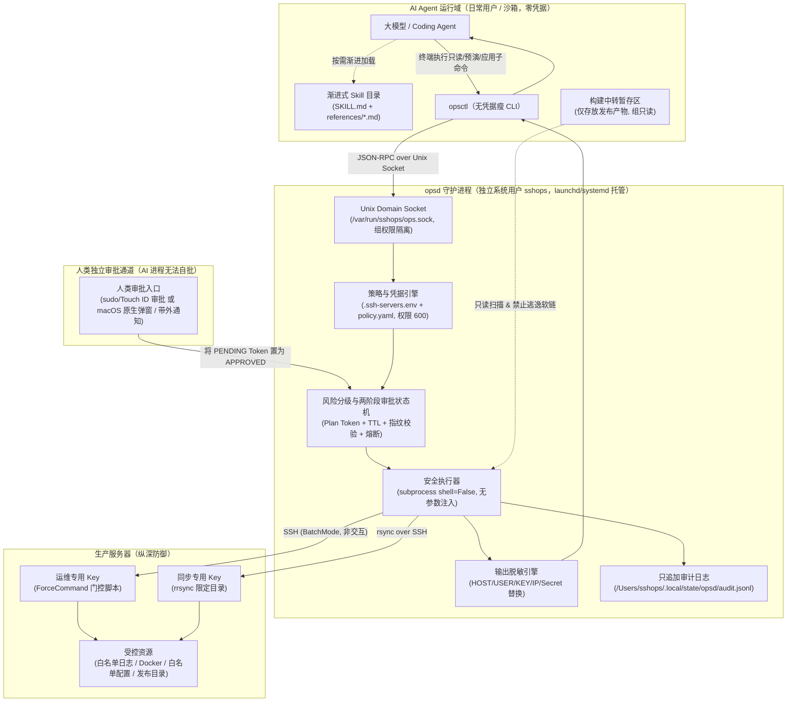

# `safe-server-ops-skill` 设计文档（安全隔离型生产服务器运维网关）

> **文档状态**：草案（v2.1）  
> **最后更新**：2026-11-24  
> **项目命名**：仓库名 `safe-server-ops-skill` ｜ Skill 名 `safe-server-ops` ｜ CLI `opsctl` ｜ 守护进程 `opsd`  
> **目标**：在不向大模型暴露 SSH 私钥、用户名、服务器地址及敏感目录结构的前提下，以**极低日常上下文占用（渐进式 Skill）**、**OS 级权限隔离**、**防 AI 自批的人工审批**和**可审计可回滚**的方式，让 AI Agent 安全执行生产服务器运维操作（读取日志、`rsync` 同步、重启 Docker、修改白名单配置）。

---

## 1. 背景、架构选型与安全目标

### 1.1 为什么不直接用本地 Shell 脚本？

直接使用同用户下的包装脚本（例如 `~/.local/bin/ssh_login.sh`）存在三个根本缺陷：
1. **OS 同用户权限穿透**：若 AI Agent 与配置文件、私钥归属同一操作系统用户，Agent 可直接读取脚本源码、明文配置与私钥文件。
2. **运行时信息反吐**：SSH 报错、Shell 提示符、`rsync` 详细日志及命令输出极易将真实 `HOST`、`USER`、`PORT`、`KEY_FILE` 暴露进大模型上下文与云端推理日志。
3. **缺少变更护栏**：裸 Shell / 裸 `rsync` 容易因幻觉或 Prompt Injection 导致误删生产数据、篡改系统关键配置或容器提权。

### 1.2 为什么从纯 MCP 升级为“Skill + 瘦 CLI + 独立守护进程”？

| 对比维度 | 纯 MCP Server 方案 | Skill + `opsctl` 瘦 CLI + `opsd` 守护进程（本设计） |
| :--- | :--- | :--- |
| **日常上下文占用** | 较高（所有 Tool 的 JSON Schema 每次会话全量常驻） | **极低**（平时仅占 ~30 Tokens 的 Skill 简介，运维时按需读取 `SKILL.md` 及分模块参考文档） |
| **凭据与 OS 级隔离** | 需额外以独立用户跑 HTTP MCP 并管理鉴权 Token | **同等 OS 隔离**，且通过 **Unix Domain Socket** 通信，直接利用内核组权限与对端身份校验，普通用户侧**零凭据、零 Token** |
| **跨 Agent 兼容性** | 依赖各客户端对 MCP 协议/HTTP/Elicitation 的支持程度 | **极强**：任何支持 Skill 和终端调用的 Coding Agent 开箱即用 |
| **扩展性（一核两壳）** | 工具越多上下文越重 | 核心全在 `opsd`；默认走 `Skill + opsctl`，未来如需接入无终端纯对话客户端，外挂一层薄 MCP Adapter 即可复用 |

### 1.3 核心安全目标

| 维度 | 设计目标 |
| :--- | :--- |
| **凭据保密性** | 大模型全程只接触**逻辑代号**（如 `prod-web-1`、`wp-plugin-release`），无法获取真实 IP/域名、端口、用户名、私钥内容及服务端敏感路径。 |
| **OS 级权限隔离** | 守护进程 `opsd` 运行在独立无登录系统用户（如 `sshops`）下，独占凭据与策略文件；AI Agent 所在进程在操作系统层面**无权读取**任何凭据。 |
| **最小能力暴露** | 不暴露交互式 Shell，也不透传任意 `rsync` / `docker` 参数；全部抽象为预声明白名单动作。 |
| **防 AI 自批的人工审批** | 只读操作（L0）自动执行；所有变更操作（L1/L2）走 **Plan/Preview → 人类独立带外/提权审批 → Apply（校验指纹后执行）**，防止 AI 自行批准自己发起的变更。 |
| **服务端纵深防御** | 生产服务器通过专用低权限账号、`ForceCommand` 门控脚本、`sudoers` 白名单与 `rrsync` 锁死操作边界。 |
| **全链路可审计可回滚** | 所有调用、Diff 与结果写入本地只追加审计日志；配置变更前强制语法预检与自动备份，重载失败自动回滚。 |

---

## 2. 总体架构



### 2.1 两档部署演进路径

| 维度 | 过渡版（本机快速验证） | 生产真隔离版（推荐最终形态） |
| :--- | :--- | :--- |
| `opsd` 运行身份 | 当前用户后台进程（仅防上下文与云端日志泄露） | 独立无登录系统用户 `sshops`（`launchd` 托管），日常用户与 AI 均无权限读 `/Users/sshops/` |
| 通信通道 | `~/.local/state/sshops/ops.sock`（`chmod 600`） | `/var/run/sshops/ops.sock`（`chown sshops:opsclients`, `chmod 660`） |
| 审批把关 | 客户端命令前缀拦截 | `opsd` 强制校验人类独立审批（`sudo` + Touch ID 或带外通知确认） |

---

## 3. 渐进式 Skill 设计（极低上下文占用）

Skill 本身只包含**无敏感信息的操作指南与安全规范**，按两级结构组织，实现按需加载：

```text
skills/safe-server-ops/
├── SKILL.md                         # 主入口（name: safe-server-ops，~80 行）：触发条件、安全铁律、opsctl 总览
└── references/
    ├── logs-and-docker.md           # 查日志、看容器状态、重启 Docker 详细用法与排障流程
    ├── rsync-deploy.md              # 构建产物放入 Staging → preview → 审批 → apply 规范
    └── config-change.md             # 配置读取 → 预检 Diff → 审批 → apply/rollback 规范
```

### 3.1 `SKILL.md` 核心约束要点
* **极简 frontmatter**：`name` 与 `description` 仅清晰描述触发场景（线上查日志、重启容器、同步发布、修改生产配置），日常对话中只占用几十个 Token。
* **强制按需阅读**：在 `SKILL.md` 中指明“仅在执行对应类型操作时读取 `references/` 下对应子文档”，避免一次性塞入全部细节。
* **行为铁律**：
  1. 始终先调用 `opsctl capabilities` 发现可用逻辑代号，绝不猜测或向用户索要生产 IP/密钥；
  2. 严禁尝试读取 `/Users/sshops/`、`~/.ssh/` 或其他凭据目录；
  3. 遇到需要人工审批的 `plan_token` 时，必须清晰向用户展示变更摘要/Diff，暂停并等待用户完成独立审批后再执行 `apply`。

---

## 4. 配置与凭据管理设计

所有配置归 `sshops` 独占（`chmod 600`），**禁止使用 `source` / `eval` 解析**，统一字面量加载。

### 4.1 服务器凭据文件（兼容现有 `.ssh-servers.env`）

复用现有分段键值对格式，建议按用途区分运维 Key 与 `rsync` 专用 Key：

```ini
[prod-web-1]
HOST=203.0.113.10
USER=ai-ops
PORT=22
KEY_FILE=/Users/sshops/.ssh/id_ed25519_ai_ops
SYNC_KEY_FILE=/Users/sshops/.ssh/id_ed25519_ai_rrsync
```

### 4.2 声明式策略文件（`policy.yaml`）

未在白名单中显式声明的服务器、日志、容器、配置或同步目录，一律默认拒绝（Deny-by-Default）：

```yaml
global:
  plan_ttl_seconds: 180          # Plan Token 有效期（3 分钟）
  max_output_bytes: 65536        # 单次输出上限（防大日志撑爆上下文）
  default_timeout_seconds: 20
  global_excludes:               # 不可被覆盖的全局排除规则
    - ".git/"
    - ".env"
    - ".env.*"
    - "*.pem"
    - "*.key"
    - "node_modules/"
    - "wp-config.php"

servers:
  prod-web-1:
    # 1. 允许读取的日志源白名单
    logs:
      nginx-error:
        type: file
        path: /var/log/nginx/error.log
        max_lines: 500
      app-container:
        type: docker
        container: web-app
        max_lines: 500

    # 2. 允许查看/重启的 Docker 目标白名单
    docker:
      allowed_containers:
        - web-app
        - nginx-proxy
      allowed_compose:
        web-stack:
          workdir: /srv/stacks/web
          services: ["web", "worker"]

    # 3. 允许修改的配置文件白名单（严禁加入 sudoers/sshd_config/私钥等系统关键文件）
    configs:
      nginx-site:
        path: /etc/nginx/conf.d/app.conf
        backup_dir: /var/backups/ai-ops/nginx
        validator: "nginx_test"         # 映射到服务端白名单校验动作（nginx -t）
        reload_action: "nginx_reload"   # 校验通过后可选的重载动作
        redact_patterns:                # 读取配置时自动脱敏的敏感字段正则
          - "(?i)(password|secret|token|api_key)\\s*[:=]\\s*\\S+"

      # 4. 允许 rsync 同步的目标白名单（归属在对应服务器下）
      sync_targets:
        wp-plugin-release:
          direction: push                     # 显式限定 push 或 pull
          local_base: /var/tmp/sshops-staging/wp-plugin-release
          remote_base: /var/www/html/wp-content/plugins/my-plugin
          allow_delete: false                 # 默认禁止 --delete
          max_delete_files: 20                # 即便允许 delete，超过阈值直接熔断
          max_files: 300
          max_size_mb: 50
          exclude_file: /Users/sshops/.local/config/opsd/excludes/wp-plugin.exclude
```

---

## 5. `opsctl` CLI 契约与统一审批状态机

所有操作按风险分为三级：
* **L0（只读查询与预演）**：直接执行返回，不改变线上状态。
* **L1（受控状态变更）** 与 **L2（高危文件/配置变更）**：统一采用两阶段状态机：

```text
[AI 调用 plan/preview]
        │ 生成一次性 plan_token（含变更摘要、内容指纹 SHA256、3 分钟 TTL）
        ▼
  PENDING_APPROVAL
        │ 人类通过独立审批通道确认（AI 进程无权触发 approve）
        ▼
     APPROVED
        │ [AI 调用 apply <plan_token>]
        │ opsd 再次校验：未过期 + 未消费 + 指纹/远端原文件哈希未变
        ▼
  EXECUTED / ROLLED_BACK
```

### 5.1 如何从根本上防止“AI 自己审批自己”？

普通用户执行 `opsctl` 与 AI Agent 处于同一权限域，因此**绝对不能**让 `opsctl approve` 成为普通用户直接无鉴权可调的子命令。可选三种防自批机制（推荐方案 1 或方案 2）：

1. **方案 1（macOS 提权审批，最零依赖推荐）**：
   * 审批命令通过受限 `sudo` 以 `sshops` 身份执行：`sudo -u sshops /usr/local/bin/ops-approve <plan_token>`；
   * **禁止给该命令配置 `NOPASSWD`**，而是依赖 macOS 的密码或 **Touch ID PAM（`pam_tid.so`）** 校验；
   * AI Agent 在非交互子进程中既没有密码也按不了指纹，**彻底无法自批**。
2. **方案 2（macOS 原生 GUI 弹窗审批）**：
   * `opsd` 收到高危 `apply` 请求时，向当前桌面会话弹出原生系统确认对话框（显示目标、动作与摘要），必须由人类点击“批准”才放行。
3. **方案 3（带外通知审批，适合远程/团队协作）**：
   * `plan` 生成后，`opsd` 自动向飞书 / Telegram / 企业微信发送带 Diff 摘要的审批卡片，人类在手机端点击确认后将 Token 状态置为 `APPROVED`。

### 5.2 CLI 子命令总览

#### 1. 能力发现（L0）
* `opsctl capabilities [--json]`
  * 返回可用服务器代号、`logs` / `docker` / `configs` / `sync_targets` 逻辑 ID 与允许方向，绝不返回 IP、路径、用户名。

#### 2. 日志与容器状态（L0）
* `opsctl logs <server> <log_id> [--lines 100] [--keyword STR] [--since 15m]`
  * `lines` 强制钳制在 `1..max_lines`；`keyword` 仅做固定字面量过滤（防正则 ReDoS 与命令注入）；返回结果统一脱敏并限流截断。
* `opsctl docker status <server> [target]`
  * 仅返回白名单容器的运行状态、健康检查、重启次数与运行时长，**严禁暴露容器 `Env` 环境变量**。

#### 3. 重启 Docker（L1：两阶段）
* `opsctl docker restart-plan <server> <target> --reason "<原因>"`（L0）
  * 校验目标在白名单内，返回容器当前状态并签发 `plan_token`。
* `opsctl docker restart-apply <plan_token>`（L1，需人类已批准）
  * 执行白名单重启；等待短时间后自动附带返回最新容器状态 + 最近 30 行脱敏启动日志，便于模型确认服务恢复正常。
  * 严禁暴露 `docker run`、`docker exec`、`docker cp` 等高危提权命令。

#### 4. `rsync` 文件同步（L2：两阶段）
* `opsctl rsync preview <target>`（L0）
  1. 校验 `target` 在白名单内且 `local_base`（Staging 目录）合法；
  2. **符号链接安全扫描**：遍历 `local_base`，只要发现任何指向 `local_base` 外部的软链立即拒绝；
  3. 校验文件总数与体积未超 `max_files` / `max_size_mb`；
  4. 执行 `rsync --dry-run --itemize-changes --stats`（参数由 `opsd` 硬编码）；
  5. 若开启 `allow_delete` 且待删除数超 `max_delete_files`（或占比超 30%），直接熔断报错；
  6. 计算待同步目录的 **Manifest SHA256 指纹**，签发 `plan_token`，返回脱敏后的变更明细。
* `opsctl rsync apply <plan_token>`（L2，需人类已批准）
  1. 校验 Token 处于 `APPROVED`、未过期、未使用（立即标记消费防重放）；
  2. **TOCTOU 防篡改校验**：重新计算 `local_base` 指纹，必须与 `preview` 时完全一致，防止模型在预览通过后偷偷篡改文件；
  3. 正式执行同步，写入审计日志并返回脱敏后的统计摘要。

#### 5. 生产配置修改与回滚（L2：两阶段 + 语法预检 + 自动回滚）
* `opsctl config read <server> <config_id>`（L0）
  * 返回配置内容及当前文件 `base_sha256`；命中 `redact_patterns` 的敏感值自动替换为 `{{REDACTED_SECRET_1}}` 占位符。
* `opsctl config plan <server> <config_id> --file <local_draft_file> --base-sha <sha> --reason "<原因>"`（L0）
  1. 校验远端当前文件哈希仍等于 `base_sha256`（防并发覆盖）；
  2. `opsd` 在内存中将未改动的脱敏占位符还原为真实密文（若检测到模型试图改写密文行则直接拒绝）；
  3. 写入远端临时文件并执行预定义**语法预检**（如 `nginx -t`、JSON/YAML 校验、`docker compose config -q`）；预检失败直接清理临时文件并返回脱敏报错，**不签发 Token**；
  4. 生成脱敏后的 **Unified Diff**，签发 `plan_token`（绑定 `base_sha256` 与 `new_sha256`）。
* `opsctl config apply <plan_token>`（L2，需人类已批准）
  1. 复检 Token 状态与远端原文件哈希；
  2. **自动备份**：原文件备份至 `backup_dir/<config_id>.<timestamp>.bak`（生成 `backup_id`）；
  3. **原子替换**：同文件系统临时文件 `mv` 覆盖；
  4. 如配置了 `reload_action`，执行重载并检查状态；**若重载失败，自动恢复刚生成的备份并重新重载**，返回详细错误与回滚状态。
* `opsctl config rollback-plan <server> <config_id> <backup_id>` → 人类批准 → `opsctl config rollback-apply <plan_token>`（L1）
  * 安全回滚到历史备份并执行校验与平滑重载。

---

## 6. 纵深防御与关键安全细节

### 6.1 输出脱敏引擎（强制中间件）

`opsd` 返回给 `opsctl` 的所有响应（包括 stdout、stderr、异常堆栈）必须统一流经脱敏管道：
1. **精确替换**：当前 Profile 的 `HOST`、`USER`、`KEY_FILE`、`SYNC_KEY_FILE`、`REMOTE_BASE` → `[REDACTED_HOST]`、`[REDACTED_USER]`、`[REDACTED_KEY]`、`[TARGET_ROOT]`。
2. **模式兜底替换**：
   * IPv4 地址 → `[REDACTED_IP]`；
   * PEM 私钥块（`-----BEGIN ... PRIVATE KEY-----`）→ `[REDACTED_PRIVATE_KEY]`；
   * 常见云凭据/连接串模式（`AKIA...`、`Bearer ...`、`mysql://...`、`postgres://...` 等）→ `[REDACTED_SECRET]`；
   * 报错中可能泄露的 `-e "ssh -i ..."` 命令回显。

### 6.2 安全执行器规范（防命令注入与软链逃逸）

* **本地执行**：Rust `std::process::Command` 直接以 `argv` 数组走 `execve` 启动（天然无 Shell 解析注入风险），配合独立管道读取线程与超时强杀。
* **内存密文清理**：`config_plan` / `config_apply` 还原的明文配置使用 `zeroize::Zeroizing<String>` 托管，消费或释放后自动擦除堆内存。
* **SSH 固定选项**：`-o BatchMode=yes -o IdentitiesOnly=yes -o ForwardAgent=no -o StrictHostKeyChecking=yes -o ConnectTimeout=10`。
* **`rsync` 固定选项**：`-rltz --no-owner --no-group --no-perms --no-devices --no-specials --safe-links --itemize-changes --stats --timeout=30`（不用模糊的 `-a`，严禁 `-L` / `--copy-links`，绝不接受外部注入 `-e` / `--rsync-path` / `--files-from`）。

### 6.3 生产服务器侧加固

1. **严禁使用 `root`，也严禁将 `ai-ops` 加入 `docker` 组**：
   * Linux 下加入 `docker` 组等价于 `root` 提权风险。
   * 通过 `/etc/sudoers.d/ai-ops` 仅授权免密执行一个 `root:root` 拥有且只读（`chmod 755`）的门控脚本 `/usr/local/bin/ai-ops-gate`，脚本内用 `case` 严格限定仅允许对白名单容器执行 `docker ps/logs/restart`、对白名单配置执行校验/备份/原子写入/重载。
2. **SSH `authorized_keys` 强制命令绑定（`ForceCommand`）**：
   * **运维 Key**：
     ```text
     command="/usr/local/bin/ai-ops-ssh-entry",no-port-forwarding,no-X11-forwarding,no-agent-forwarding,no-pty ssh-ed25519 AAAA... ai-ops
     ```
     彻底封死交互式 Shell，只接受预定义结构化子命令。
   * **`rsync` 专用 Key（`rrsync`）**：
     ```text
     command="/usr/bin/rrsync -wo /var/www/html/wp-content/plugins/my-plugin",no-port-forwarding,no-X11-forwarding,no-agent-forwarding,no-pty ssh-ed25519 AAAA... ai-rrsync
     ```
     `-wo` 限定只写不读且目录锁死在目标发布目录内。

### 6.4 审计日志

在 `/Users/sshops/.local/state/opsd/audit.jsonl` 以只追加（`0600`）方式记录每次请求与审批事件：

```json
{
  "ts": "2026-11-24T08:55:00+08:00",
  "action": "rsync_apply",
  "server": "prod-web-1",
  "target": "wp-plugin-release",
  "plan_token_id": "pln_9f2a1c",
  "approved_by": "human:touchid",
  "manifest_sha256": "e3b0c442...",
  "exit_code": 0,
  "duration_ms": 1420,
  "summary": "sent=12 files, deleted=0, bytes=48210"
}
```

---

## 7. 项目目录结构（纯 Rust 零依赖单二进制实现）

独立仓库维护（不要放进业务代码仓库，避免误提交）：

```text
safe-server-ops-skill/
├── Cargo.toml
├── Cargo.lock
├── DESIGN.md / INSTALL.md / README.md
├── skills/safe-server-ops/        # 渐进式 Skill 目录（安装到 Agent 的 skills 目录）
│   ├── SKILL.md
│   └── references/
│       ├── logs-and-docker.md
│       ├── rsync-deploy.md
│       └── config-change.md
├── src/
│   ├── lib.rs
│   ├── bin/
│   │   ├── opsd.rs                # 守护进程二进制（监听 ops.sock + 0600 admin.sock）
│   │   ├── opsctl.rs              # 零凭据瘦客户端二进制
│   │   └── ops-approve.rs         # 人类独立审批工具二进制（连接 admin.sock）
│   ├── protocol.rs                # Unix Domain Socket NDJSON 通信协议
│   ├── config.rs                  # opsd.conf / .ssh-servers.env / policy.yaml 强校验解析
│   ├── planner.rs                 # 统一 Plan Token 状态机（含 zeroize 内存密文清零）
│   ├── redactor.rs                # 脱敏引擎（凭据 + IP + Secret + 密文占位符还原）
│   ├── audit.rs                   # 只追加 JSONL 审计日志（0600）
│   ├── engine.rs                  # 策略路由（client 通道严格拒绝 admin.* 防 AI 自批）
│   ├── daemon.rs                  # 双 Unix Socket 监听与属组权限管理
│   └── executors/
│       ├── ssh_exec.rs            # 直接 execve 的安全 SSH/子进程封装（带超时强杀）
│       ├── logs.rs                # 日志读取与 Docker 状态
│       ├── docker_ops.rs          # Docker 白名单两阶段重启与启动日志回传
│       ├── rsync_ops.rs           # rsync 预演、软链逃逸扫描、TOCTOU 指纹校验与删除熔断
│       └── config_ops.rs          # 配置脱敏读取、密文还原、语法预检、Diff、备份与回滚
├── tests/
│   └── security_and_e2e.rs        # 安全边界单测 + 真实编译二进制双 Socket 端到端测试
├── remote/                        # 部署到生产服务器的门控脚本
│   ├── ai-ops-gate.sh             # 服务端 sudoers 白名单门控脚本
│   └── ai-ops-ssh-entry.sh        # authorized_keys ForceCommand 入口
└── deploy/
    ├── 0-bootstrap-macos.sh       # 一键全自动部署入口（串联 1->2->3 + Key/模板/Skill/launchd）
    ├── 1-create-sshops-user.sh    # 第 1 步：创建隐藏受限用户 sshops 与组 opsclients
    ├── 2-setup-macos-isolation.sh # 第 2 步：初始化 /Users/sshops 与共享 Socket/Staging 目录
    ├── 3-install.sh               # 第 3 步：编译并双端隔离安装 3 个原生二进制
    ├── 4-add-server.sh            # 第 4 步：交互录入或导入 ssh_login.sh 配置 + 写 known_hosts
    ├── com.local.safe-server-opsd.plist  # macOS launchd 守护进程配置（以 sshops 运行）
    ├── opsd.example.conf          # opsd.conf 主配置模板
    ├── ssh-servers.example.env    # 服务器凭据模板
    └── policy.example.yaml        # 策略配置模板
```

---

## 8. 分阶段实施路线图

建议按风险从低到高分 4 个阶段落地，每阶段独立验收：

1. **Phase 1：核心骨架 + Skill + L0 只读能力 + 脱敏审计**
   * 完成 `opsd`（Unix Socket）+ `opsctl` + `.ssh-servers.env`/`policy.yaml` 解析 + 脱敏引擎 + 审计日志；
   * 落地 `capabilities`、`logs`、`docker status` 以及初版 `skill/SKILL.md`；
   * 验证：任意报错与输出绝不泄漏 `HOST` / `USER` / `KEY_FILE` / IP，且日常非运维会话上下文几乎零占用。
2. **Phase 2：统一审批状态机 + `rsync` 两阶段安全同步**
   * 落地 `planner.rs` 与防 AI 自批的 `ops-approve`（`sudo`/Touch ID）；
   * 落地 `rsync preview` / `rsync apply`（软链扫描 + Manifest 指纹校验 + `--delete` 熔断）；
   * 在生产机配置 `rrsync` 专用 Key 并完成发布演练。
3. **Phase 3：Docker 重启与配置修改闭环**
   * 落地 `docker restart-plan/apply`（含重启后状态与启动日志自动回传）；
   * 落地 `config read/plan/apply/rollback` 及生产机 `ai-ops-gate.sh` 语法校验、自动备份与重载失败自动回滚。
4. **Phase 4：OS 级真隔离上线**
   * 创建本机独立用户 `sshops`、Staging 中转目录与 `launchd` 服务；
   * 验证日常用户执行 `cat /Users/sshops/.local/config/opsd/.ssh-servers.env` 返回 `Permission denied`、AI 无法自行调用 `ops-approve`，完成全链路安全验收。
