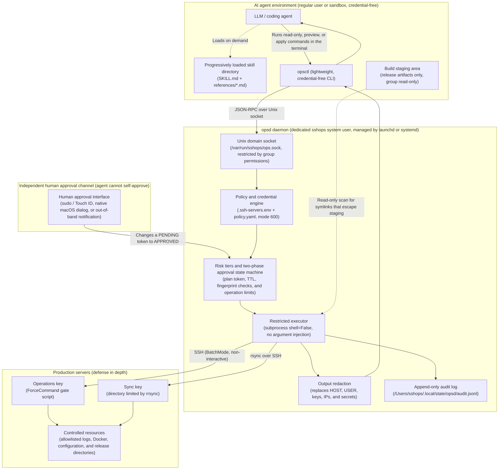

# `safe-server-ops-skill` design

[简体中文](DESIGN_zh.md)

> **Status** Draft (v2.1)
>
> **Last updated** 2026-11-24
>
> **Project names** Repository `safe-server-ops-skill` · skill `safe-server-ops` · CLI `opsctl` · daemon `opsd`
>
> **Goal** Let AI agents read production logs, sync files with `rsync`, restart Docker workloads, and edit allowlisted configuration. The design keeps SSH private keys, usernames, server addresses, and sensitive directory layouts out of the model's context. It loads the skill on demand, isolates permissions at the OS level, requires independent human approval for changes, and supports auditing and rollback.

---

## 1. Background, architecture choices, and security goals

### 1.1 Limitations of local shell wrappers

Running a wrapper such as `~/.local/bin/ssh_login.sh` under the agent's OS account has three limitations.

1. **Shared OS permissions.** If the agent, configuration files, and private keys share an OS account, the agent can directly read the wrapper source, plaintext configuration, and private key files.
2. **Sensitive data in command output.** SSH errors, shell prompts, verbose `rsync` logs, and command output can expose the actual `HOST`, `USER`, `PORT`, and `KEY_FILE` to the model and cloud inference logs.
3. **Unrestricted changes.** A shell or unrestricted `rsync` invocation can let a model error or prompt injection delete production data, modify critical system configuration, or escalate privileges through a container.

### 1.2 Skill, lightweight CLI, and separate daemon

| Dimension | MCP server | Skill, `opsctl` CLI, and `opsd` daemon |
| :--- | :--- | :--- |
| **Context overhead** | Every session loads the full JSON schemas for all tools. | A roughly 30-token skill description stays in context. The agent loads `SKILL.md` and individual reference documents as needed. |
| **Credential and OS isolation** | An HTTP MCP server needs a dedicated OS user and authentication tokens. | A Unix domain socket uses kernel group permissions and peer identity checks. The regular user needs no credentials or tokens. |
| **Agent compatibility** | Depends on each client's support for MCP, HTTP, and elicitation. | Works with coding agents that can load skills and run terminal commands. |
| **Extensibility** | Additional tools increase context use. | `opsd` contains the core logic. The skill and `opsctl` are the default interface. A thin MCP adapter could reuse the daemon for chat clients without a terminal. |

### 1.3 Security goals

| Dimension | Goal |
| :--- | :--- |
| **Credential confidentiality** | The model sees logical aliases such as `prod-web-1` and `wp-plugin-release`. The gateway withholds actual IP addresses, domains, ports, usernames, private keys, and sensitive server paths. |
| **OS-level permission isolation** | `opsd` runs as a dedicated non-login system user such as `sshops` and owns the credential and policy files. The agent's OS identity has no read access to those credentials. |
| **Limited capabilities** | Expose predefined allowlisted actions. Interactive shells and arbitrary `rsync` or `docker` arguments are outside this interface. |
| **Independent human approval** | Execute read-only L0 operations directly. L1 and L2 changes require a plan or preview, independent human approval through an elevated or out-of-band channel, and fingerprint verification at apply time. |
| **Server-side defense in depth** | A dedicated low-privilege account, an SSH `ForceCommand` gate, a `sudoers` allowlist, and `rrsync` restrict server-side operations. |
| **Auditing and rollback** | Write all calls, diffs, and results to a local append-only audit log. Check configuration syntax and back up the file before changes. Restore the backup automatically if reload fails. |

---

## 2. Architecture



### 2.1 Local trial and production deployment

| Dimension | Local trial | Isolated production deployment (recommended) |
| :--- | :--- | :--- |
| `opsd` identity | Runs in the background as the current user. Protects against leaks into model context and cloud logs. | Runs under `launchd` as the dedicated non-login user `sshops`. The regular user and the agent have no read access to `/Users/sshops/`. |
| Communication channel | `~/.local/state/sshops/ops.sock` (`chmod 600`) | `/var/run/sshops/ops.sock` (`chown sshops:opsclients`, `chmod 660`) |
| Approval enforcement | Client-side command-prefix checks. | `opsd` requires independent human approval through `sudo` with Touch ID or an out-of-band confirmation. |

---

## 3. On-demand skill loading

The skill contains non-sensitive operational guidance and security rules. Its two-level layout lets agents load the relevant instructions on demand.

```text
skills/safe-server-ops/
├── SKILL.md                         # Entry point (name: safe-server-ops, ~80 lines) with triggers, security rules, and an opsctl overview
└── references/
    ├── logs-and-docker.md           # Read logs, inspect containers, restart Docker, and troubleshoot
    ├── rsync-deploy.md              # Stage artifacts, preview the sync, get approval, and apply
    └── config-change.md            # Read configuration, preview a diff, get approval, and apply or roll back
```

### 3.1 Rules in `SKILL.md`

* **Minimal front matter.** The `name` and `description` identify when to load the skill for production logs, container restarts, deployment syncs, and configuration edits. The description takes up only a few dozen tokens in regular conversations.
* **Load references as needed.** The skill directs the agent to read only the file in `references/` relevant to the current operation.
* **Required agent behavior**
  1. Run `opsctl capabilities` first to discover available logical aliases. Keep production IPs and keys out of agent requests and avoid guessing them.
  2. Keep `/Users/sshops/`, `~/.ssh/`, and other credential directories off-limits.
  3. When a `plan_token` requires approval, show the user a clear change summary or diff. Wait for independent human approval before running `apply`.

---

## 4. Configuration and credential management

All configuration belongs to `sshops` and uses mode `600`. The daemon parses the files as literal data and prohibits `source` or `eval` during parsing.

### 4.1 Server credentials (`.ssh-servers.env`)

The file uses the existing section-based key-value format. Use separate keys for operations and `rsync`.

```ini
[prod-web-1]
HOST=203.0.113.10
USER=ai-ops
PORT=22
KEY_FILE=/Users/sshops/.ssh/id_ed25519_ai_ops
SYNC_KEY_FILE=/Users/sshops/.ssh/id_ed25519_ai_rrsync
```

### 4.2 Declarative policy (`policy.yaml`)

The deny-by-default policy requires an explicit allowlist entry for servers, logs, containers, configuration files, and sync directories.

```yaml
global:
  plan_ttl_seconds: 180          # Plan token lifetime (3 minutes)
  max_output_bytes: 65536        # Maximum output per request to limit context use
  default_timeout_seconds: 20
  global_excludes:               # Global exclusions that cannot be overridden
    - ".git/"
    - ".env"
    - ".env.*"
    - "*.pem"
    - "*.key"
    - "node_modules/"
    - "wp-config.php"

servers:
  prod-web-1:
    # 1. Log sources the agent can read
    logs:
      nginx-error:
        type: file
        path: /var/log/nginx/error.log
        max_lines: 500
      app-container:
        type: docker
        container: web-app
        max_lines: 500

    # 2. Docker workloads the agent can inspect or restart
    docker:
      allowed_containers:
        - web-app
        - nginx-proxy
      allowed_compose:
        web-stack:
          workdir: /srv/stacks/web
          services: ["web", "worker"]

    # 3. Editable configuration files. Keep sudoers, sshd_config, and private keys out of this list.
    configs:
      nginx-site:
        path: /etc/nginx/conf.d/app.conf
        backup_dir: /var/backups/ai-ops/nginx
        validator: "nginx_test"         # Maps to the server-side allowlisted nginx -t check
        reload_action: "nginx_reload"   # Optional reload after successful validation
        redact_patterns:                # Patterns for sensitive fields to redact on read
          - "(?i)(password|secret|token|api_key)\\s*[:=]\\s*\\S+"

      # 4. Allowed rsync targets for this server
      sync_targets:
        wp-plugin-release:
          direction: push                     # Explicitly restrict to push or pull
          local_base: /var/tmp/sshops-staging/wp-plugin-release
          remote_base: /var/www/html/wp-content/plugins/my-plugin
          allow_delete: false                 # Disable --delete by default
          max_delete_files: 20                # Abort above this limit even when deletion is enabled
          max_files: 300
          max_size_mb: 50
          exclude_file: /Users/sshops/.local/config/opsd/excludes/wp-plugin.exclude
```

---

## 5. `opsctl` CLI contract and approval state machine

* **L0 (read-only queries and previews).** Execute directly without changing production state.
* **L1 (controlled state changes) and L2 (high-risk changes to files or configuration).** Use the same two-phase state machine.

```text
[Agent calls plan/preview]
        │ Issues a single-use plan_token with a change summary, SHA-256 fingerprint, and 3-minute TTL
        ▼
  PENDING_APPROVAL
        │ A human confirms through an independent approval channel
        ▼
     APPROVED
        │ [Agent calls apply <plan_token>]
        │ opsd checks that the token is unexpired and unused and that the fingerprint or remote base hash still matches
        ▼
  EXECUTED / ROLLED_BACK
```

### 5.1 Preventing agent self-approval

The regular user and the agent run `opsctl` with the same permissions. An `opsctl approve` subcommand would therefore require independent authentication. The design considers three options and recommends option 1 or 2.

1. **Elevated approval on macOS (recommended for minimal dependencies)**
   * Run the approval command as `sshops` through restricted `sudo` using `sudo -u sshops /usr/local/bin/ops-approve <plan_token>`.
   * Require the user's macOS password or Touch ID through PAM (`pam_tid.so`). Disallow `NOPASSWD` for this command.
   * A non-interactive agent process has neither the user's password nor their fingerprint, so it cannot approve its own request.
2. **Native macOS approval dialog**
   * When `opsd` receives a high-risk `apply` request, it shows a native confirmation dialog in the current desktop session with the target, action, and summary. A human must click **Approve** before the operation proceeds.
3. **Out-of-band notification (for remote users or teams)**
   * When the plan is created, `opsd` sends an approval message with a diff summary through Feishu, Telegram, or WeCom. A human confirms on their phone, which sets the token state to `APPROVED`.

### 5.2 CLI commands

#### 1. Discover capabilities (L0)

* `opsctl capabilities [--json]`
  * Returns available server aliases, logical IDs for `logs`, `docker`, `configs`, and `sync_targets`, and allowed sync directions. Output excludes IP addresses, paths, and usernames.

#### 2. Read logs and inspect containers (L0)

* `opsctl logs <server> <log_id> [--lines 100] [--keyword STR] [--since 15m]`
  * Clamps `lines` to `1..max_lines`. Matches `keyword` as literal text to avoid regex denial of service (ReDoS) and command injection. The gateway redacts and truncates the output.
* `opsctl docker status <server> [target]`
  * Returns the running state, health status, restart count, and uptime for allowlisted workloads. Container `Env` variables are excluded.

#### 3. Restart Docker (L1, two phases)

* `opsctl docker restart-plan <server> <target> --reason "<reason>"` (L0)
  * Checks that the target is allowlisted, returns its current state, and issues a `plan_token`.
* `opsctl docker restart-apply <plan_token>` (L1, requires prior human approval)
  * Restarts the allowlisted workload. After a short wait, returns the latest container status and the 30 most recent startup log lines with sensitive values redacted.
  * The interface excludes privilege-sensitive commands such as `docker run`, `docker exec`, and `docker cp`.

#### 4. Sync files with `rsync` (L2, two phases)

* `opsctl rsync preview <target>` (L0)
  1. Check that `target` is allowlisted and that `local_base` is a valid staging directory.
  2. Scan `local_base` and reject symlinks whose targets resolve outside it.
  3. Check the file count and total size against `max_files` and `max_size_mb`.
  4. Run `rsync --dry-run --itemize-changes --stats` with arguments defined by `opsd`.
  5. If `allow_delete` is enabled, abort when the number of pending deletions exceeds `max_delete_files` or the deletion share exceeds 30%.
  6. Compute the SHA-256 manifest fingerprint for the sync directory, issue a `plan_token`, and return a redacted change list.
* `opsctl rsync apply <plan_token>` (L2, requires prior human approval)
  1. Verify that the token is `APPROVED`, unexpired, and unused. Mark it as consumed immediately to prevent replay.
  2. Recompute the fingerprint of `local_base` and require an exact match with the preview. This catches changes to staged files between the check and execution (TOCTOU).
  3. Execute the sync, record it in the audit log, and return redacted summary statistics.

#### 5. Edit or roll back production configuration (L2, two phases with validation and automatic rollback)

* `opsctl config read <server> <config_id>` (L0)
  * Returns the configuration and its current `base_sha256`. Sensitive values matching `redact_patterns` are replaced with placeholders such as `{{REDACTED_SECRET_1}}`.
* `opsctl config plan <server> <config_id> --file <local_draft_file> --base-sha <sha> --reason "<reason>"` (L0)
  1. Check that the remote file still hashes to `base_sha256` to prevent overwriting a concurrent edit.
  2. Restore the original secret values in memory where placeholders are intact. Reject attempts to edit lines containing those secrets.
  3. Write a temporary file on the remote server and run the configured syntax checks, such as `nginx -t`, JSON/YAML validation, or `docker compose config -q`. If validation fails, remove the temporary file, return a redacted error, and withhold the token.
  4. Generate a redacted unified diff and issue a `plan_token` bound to `base_sha256` and `new_sha256`.
* `opsctl config apply <plan_token>` (L2, requires prior human approval)
  1. Recheck the token state and the original remote file hash.
  2. Back up the original file to `backup_dir/<config_id>.<timestamp>.bak` and generate a `backup_id`.
  3. Replace the file atomically with `mv` from a temporary file on the same filesystem.
  4. If `reload_action` is configured, reload and check the result. If reload fails, restore the new backup, reload again, and report the error and rollback status.
* `opsctl config rollback-plan <server> <config_id> <backup_id>` → human approval → `opsctl config rollback-apply <plan_token>` (L1)
  * Validates and restores a previous backup, then performs a graceful reload.

---

## 6. Defense in depth

### 6.1 Mandatory output redaction

Every response from `opsd` to `opsctl`, including stdout, stderr, and stack traces, passes through the redaction pipeline.

1. **Exact-value redaction.** Replace the current profile's `HOST`, `USER`, `KEY_FILE`, `SYNC_KEY_FILE`, and `REMOTE_BASE` values with `[REDACTED_HOST]`, `[REDACTED_USER]`, `[REDACTED_KEY]`, and `[TARGET_ROOT]` as appropriate.
2. **Pattern-based redaction**
   * IPv4 addresses become `[REDACTED_IP]`.
   * PEM private key blocks (`-----BEGIN ... PRIVATE KEY-----`) become `[REDACTED_PRIVATE_KEY]`.
   * Common cloud credentials and connection strings, such as `AKIA...`, `Bearer ...`, `mysql://...`, and `postgres://...`, become `[REDACTED_SECRET]`.
   * Redact echoed arguments such as `-e "ssh -i ..."` that may appear in errors.

### 6.2 Restricted subprocess execution

* **Local execution.** Rust's `std::process::Command` launches processes with an `argv` array through `execve`, bypassing shell parsing. Separate reader threads drain the pipes, and timed-out subprocesses are forcibly terminated.
* **In-memory secret cleanup.** `config_plan` and `config_apply` keep reconstructed plaintext configuration in `zeroize::Zeroizing<String>` so it is cleared from heap memory when consumed or dropped.
* **Fixed SSH options.** `-o BatchMode=yes -o IdentitiesOnly=yes -o ForwardAgent=no -o StrictHostKeyChecking=yes -o ConnectTimeout=10`.
* **Fixed `rsync` options.** `-rltz --no-owner --no-group --no-perms --no-devices --no-specials --safe-links --itemize-changes --stats --timeout=30`. The executor prohibits `-a`, `-L`, and `--copy-links` and rejects externally supplied `-e`, `--rsync-path`, or `--files-from`.

### 6.3 Production server hardening

1. **Run the operations account with low privileges.** Use a non-root account and keep `ai-ops` out of the `docker` group.
   * On Linux, membership in the `docker` group can effectively grant root privileges.
   * `/etc/sudoers.d/ai-ops` allows passwordless execution of a single gate script, `/usr/local/bin/ai-ops-gate`, owned by `root:root` with mode `755` so only its owner can modify it. A `case` allowlist limits it to `docker ps/logs/restart` on allowlisted containers and validation, backup, atomic writes, or reload for allowlisted configuration files.
2. **Bind each SSH key to a forced command in `authorized_keys`.**
   * **Operations key**
     ```text
     command="/usr/local/bin/ai-ops-ssh-entry",no-port-forwarding,no-X11-forwarding,no-agent-forwarding,no-pty ssh-ed25519 AAAA... ai-ops
     ```
     The entry point accepts predefined structured subcommands and blocks interactive shells.
   * **Dedicated `rsync` key**
     ```text
     command="/usr/bin/rrsync -wo /var/www/html/wp-content/plugins/my-plugin",no-port-forwarding,no-X11-forwarding,no-agent-forwarding,no-pty ssh-ed25519 AAAA... ai-rrsync
     ```
     The `-wo` option allows writes only. The path limits access to the designated release directory.

### 6.4 Audit log

Record every request and approval event in the append-only log at `/Users/sshops/.local/state/opsd/audit.jsonl` with mode `0600`.

```json
{
  "ts": "2026-11-24T08:55:00+08:00",
  "action": "rsync_apply",
  "server": "prod-web-1",
  "target": "wp-plugin-release",
  "plan_token_id": "pln_9f2a1c",
  "approved_by": "human:touchid",
  "manifest_sha256": "e3b0c442...",
  "exit_code": 0,
  "duration_ms": 1420,
  "summary": "sent=12 files, deleted=0, bytes=48210"
}
```

---

## 7. Repository layout

Keep the gateway in a dedicated repository to avoid inadvertently committing its files to an application repository. The Rust implementation builds standalone native binaries.

```text
safe-server-ops-skill/
├── Cargo.toml
├── Cargo.lock
├── README.md / README_zh.md
├── docs/
│   ├── DESIGN.md / DESIGN_zh.md
│   └── INSTALL.md / INSTALL_zh.md
├── skills/safe-server-ops/        # Skill directory linked into the agent's skills directory
│   ├── SKILL.md
│   └── references/
│       ├── logs-and-docker.md
│       ├── rsync-deploy.md
│       └── config-change.md
├── src/
│   ├── lib.rs
│   ├── bin/
│   │   ├── opsd.rs                # Daemon listening on ops.sock and the mode 0600 admin.sock
│   │   ├── opsctl.rs              # Lightweight, credential-free CLI
│   │   └── ops-approve.rs         # Independent human approval tool that connects to admin.sock
│   ├── protocol.rs                # NDJSON protocol over Unix domain sockets
│   ├── config.rs                  # Strict parsing of opsd.conf, .ssh-servers.env, and policy.yaml
│   ├── planner.rs                 # Plan token state machine with zeroize cleanup for secrets
│   ├── redactor.rs                # Credential, IP, and secret redaction and placeholder restoration
│   ├── audit.rs                   # Append-only JSONL audit log (0600)
│   ├── engine.rs                  # Policy routing that denies admin.* methods on the client channel
│   ├── daemon.rs                  # Unix socket listeners and group permissions
│   └── executors/
│       ├── ssh_exec.rs            # SSH and subprocess execution through execve with timeouts
│       ├── logs.rs                # Log reads and Docker status
│       ├── docker_ops.rs          # Two-phase restarts for allowlisted workloads with startup logs
│       ├── rsync_ops.rs           # Dry run, symlink checks, TOCTOU fingerprint checks, and deletion limits
│       └── config_ops.rs          # Redaction, secret restoration, validation, diffs, backup, and rollback
├── tests/
│   └── security_and_e2e.rs        # Security-boundary tests and end-to-end tests of both sockets
├── remote/                        # Gate scripts for production servers
│   ├── ai-ops-gate.sh             # Server-side allowlist gate for sudoers
│   └── ai-ops-ssh-entry.sh        # Forced command entry point for authorized_keys
└── deploy/
    ├── 0-bootstrap-macos.sh       # Runs steps 1–3 and initializes keys, templates, skill, and launchd
    ├── 1-create-sshops-user.sh    # Creates the hidden sshops user and opsclients group
    ├── 2-setup-macos-isolation.sh # Creates /Users/sshops and the shared socket and staging directories
    ├── 3-install.sh               # Builds and installs the three binaries under the appropriate users
    ├── 4-add-server.sh            # Adds or imports ssh_login.sh server settings and updates known_hosts
    ├── com.local.safe-server-opsd.plist  # macOS launchd job that runs as sshops
    ├── opsd.example.conf          # Main configuration template
    ├── ssh-servers.example.env    # Server credential configuration template
    └── policy.example.yaml        # Policy template
```

---

## 8. Implementation roadmap

Implement the design in four phases, starting with lower-risk operations and validating each phase independently.

1. **Phase 1 — core, skill, L0 read-only operations, and redacted auditing**
   * Implement `opsd` and its Unix socket, `opsctl`, parsing for `.ssh-servers.env` and `policy.yaml`, output redaction, and audit logging.
   * Implement `capabilities`, `logs`, and `docker status`, and draft `skill/SKILL.md`.
   * Verify that errors and output exclude `HOST`, `USER`, `KEY_FILE`, and IP addresses and that non-operations sessions use minimal context.
2. **Phase 2 — shared approval state machine and two-phase `rsync`**
   * Implement `planner.rs` and independent approval through `ops-approve` with `sudo` and Touch ID.
   * Implement `rsync preview` and `rsync apply` with symlink scanning, manifest fingerprint checks, and `--delete` limits.
   * Configure a dedicated `rrsync` key on the production server and complete a release dry run.
3. **Phase 3 — Docker restarts and configuration changes**
   * Implement `docker restart-plan/apply` with post-restart status and startup logs.
   * Implement `config read/plan/apply/rollback` and server-side validation, backup, and automatic rollback on reload failure through `ai-ops-gate.sh`.
4. **Phase 4 — production rollout with OS-level isolation**
   * Create the dedicated local `sshops` account, staging directory, and `launchd` service.
   * Complete the security checks. Running `cat /Users/sshops/.local/config/opsd/.ssh-servers.env` as the regular user must return `Permission denied`, and the agent process must be unable to run `ops-approve` on its own.
